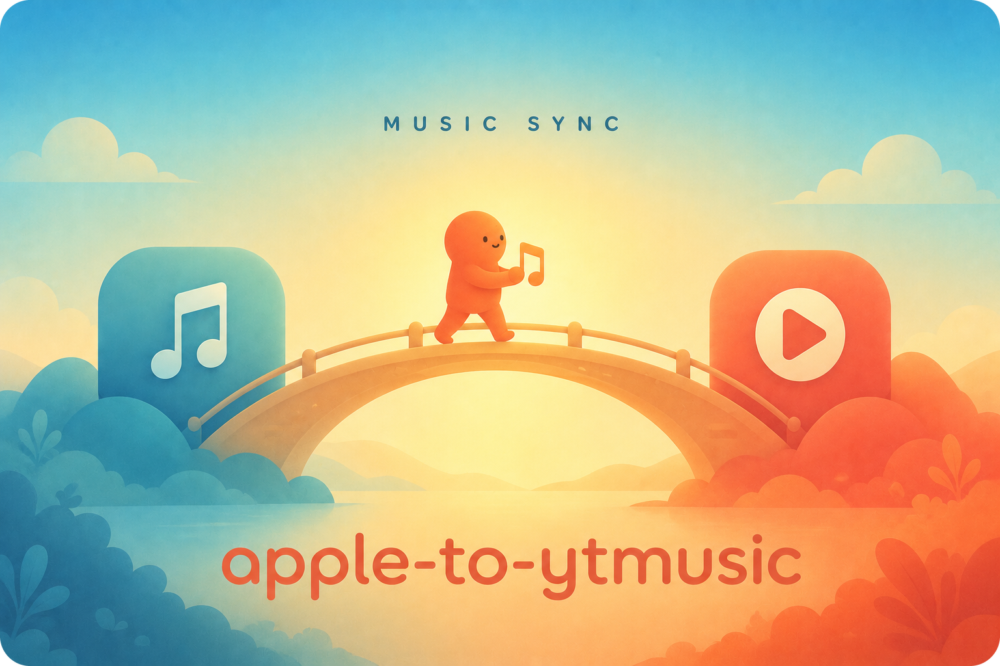

<!--
GitHub metadata — authored here, applied by hand in repo Settings (NOT rendered on the page):
About:  Mirror Apple Music playlists (shared URL, artist Top Songs, or private library) to
        YouTube Music & download them offline — a Python CLI on ytmusicapi and streamlist.
Topics (ranked): apple-music, youtube-music, playlist-sync, ytmusicapi, streamlist, python,
        macos, applescript, cli, offline-download, ipod, auto-sync, launchd, music-mirror,
        playlist-migration
Social preview: docs/media/hero.png (1280×640).
-->

# apple-to-ytmusic — Apple Music → YouTube Music playlist mirror

**Mirror any Apple Music playlist to YouTube Music, offline-ready.**  
*A single Python script that scrapes Apple Music, matches tracks on YouTube Music via
`ytmusicapi`, and hands off to `streamlist` for iPod-ready downloads.*


<p align="center">
  
</p>

Re-runs — and a weekly auto-sync — add only *new* songs and never delete anything.

## The map

| Input mode | What it does |
|---|---|
| **Shared URL** (`--url <playlist link>`) | Reads the track list straight off the public Apple Music page — no library membership needed |
| **Artist URL** (`--url <artist link>`) | Mirrors that artist's full Top Songs list (50–100 tracks, via Apple's public API) as `"<Artist> — Top Songs"` |
| **Library playlist** (`--playlist "<name>"`) | Reads a private playlist from your own Apple Music library via AppleScript |

## Quick start

```bash
/Library/Frameworks/Python.framework/Versions/3.13/bin/python3 -m pip install -r requirements.txt
/Library/Frameworks/Python.framework/Versions/3.13/bin/ytmusicapi browser --file browser.json
/Library/Frameworks/Python.framework/Versions/3.13/bin/python3 apple_to_ytmusic.py
```

1. **Install** dependencies under the 3.13 framework interpreter — not the system `python3`
   (that's 3.14 and lacks `yt_dlp` / `ytmusicapi`).
2. **Authenticate** once with `ytmusicapi browser` (steps below).
3. **Run** the script — paste a URL, or pick a library playlist, then choose whether to download.

Matched tracks land in a YouTube Music playlist (and, if you chose to download, in
`~/Music/apple-to-ytmusic`) — that's it, everything below is detail.

---

## YouTube Music auth (one-time)

Browser-header auth, no Google Cloud project needed. Use the `ytmusicapi` **command** installed
beside the 3.13 python — not `python -m ytmusicapi` (no `__main__`, it errors):

```bash
/Library/Frameworks/Python.framework/Versions/3.13/bin/ytmusicapi browser --file browser.json
```

1. **Open** `music.youtube.com`, logged in to the account playlists should be created under.
2. **DevTools** (Cmd+Option+I) → Network tab → reload → left-click any `browse` request to
   `music.youtube.com`.
3. **Copy headers** — detail panel → Headers → Request Headers → click **Raw** → select all
   (Cmd+A) → copy → paste into the prompt → Enter → Ctrl-D.

Use **Chrome/Firefox/Edge** — Safari's header format doesn't parse. Use the **Raw** view, not the
expanded name/value view (that pulls in `:authority`/`:path` pseudo-headers and breaks parsing).

Run the auth command from inside this folder (or keep `--file browser.json`) so the file lands
next to the script. The tool auto-detects a missing/invalid creds file and points you back here.
Credentials expire periodically — just re-run this step.

**Fallback (oauth)** — requires a Google "TV & Limited Input" OAuth client:

```bash
/Library/Frameworks/Python.framework/Versions/3.13/bin/ytmusicapi oauth --file oauth.json
```

Then pass it with `--creds oauth.json`.

---

## Usage & flags

Interactive:

```bash
/Library/Frameworks/Python.framework/Versions/3.13/bin/python3 apple_to_ytmusic.py
```

Direct:

```bash
# Shared Apple Music playlist URL (not in your library):
... apple_to_ytmusic.py --url "https://music.apple.com/us/playlist/…/pl.xxxxx"

# Artist URL (mirrors their Top Songs):
... apple_to_ytmusic.py --url "https://music.apple.com/in/artist/vidhya-gopal/1121565525"

# Library playlist by name:
... apple_to_ytmusic.py --playlist "French Songs"
```

| Flag | Effect |
|---|---|
| `--url <apple music url>` | Mirror a public/shared playlist, or an artist URL to mirror Top Songs |
| `--playlist "<name>"` | Mirror a library playlist by name (skips the picker) |
| `--no-download` | Create/update the YT Music playlist and stop; no download |
| `--report-only` | Search & score only; write `match_report.csv`; create nothing |
| `--stage1-only` | Just read and print the tracks — no credentials needed, quickest sanity check |
| `--sync` | Re-check every tracked playlist, add only new songs (what the weekly job runs) |
| `--install-weekly` / `--uninstall-weekly` | Install/remove a launchd job that runs `--sync` every Sunday 03:00, logs to `sync.log` |
| `--out <dir>` | Download / report directory (default `~/Music/apple-to-ytmusic`) |
| `--creds <path>` | ytmusicapi creds file (default `browser.json` beside the script) |

---

## Weekly auto-sync

```bash
... apple_to_ytmusic.py --install-weekly
```

Every Sunday at 03:00 the tool re-reads each mirrored playlist (from its original URL or library
name, remembered in `runs.json`) and adds any songs that appeared since last time. It **never
removes** tracks. Check `sync.log` for what it did.

- **URL-sourced** playlists sync completely headlessly.
- **Library-sourced** playlists need Apple Music running at sync time (AppleScript talks to the
  app). If it isn't running, that playlist is skipped and logged — the next run catches up.

Test it immediately without waiting a week:

```bash
launchctl kickstart -k gui/$(id -u)/com.adinath.apple-to-ytmusic.sync
```

---

## How it works

1. **Read** — a URL is scraped from the public Apple Music page (title/artist/duration from the
   embedded `serialized-server-data`); a library playlist is read via AppleScript (`osascript`),
   using a `\x1f`-delimited dump so titles with commas/accents survive intact.
2. **Match + create** (`ytmusicapi`) — searches YT Music per track, scores candidates on
   artist/title similarity + duration proximity (studio-preferred), picks the best match or falls
   back to the raw top hit if nothing clears the confidence bar. Creates or reuses a same-named
   YT Music playlist and adds matched tracks. Writes `match_report.csv` — check the `confidence`
   column (`confident` / `fallback` / `none`).
3. **Download** (optional; reuses `streamlist`) — downloads the YT Music playlist as AAC/M4A with
   tags, ready for an iPod.

`runs.json` remembers, per playlist, its YouTube Music id, its source (URL or library name), and
which videoIds were already added — so re-runs and the weekly sync only add new songs and never
create duplicates. The artist-mode key is the artist **name**, so the same artist reached via
different storefront URLs (`/us/`, `/in/`, …) converges to one entry, and the downloaded
album-artist tag is the artist name (not the default `"Aey - …"`).

See **[EXPLAINER.md](EXPLAINER.md)** for a ground-up walkthrough.

---

## Requirements

- macOS with the Apple Music app installed and signed in (only needed for *library* mode).
- The Python 3.13 framework interpreter:
  `/Library/Frameworks/Python.framework/Versions/3.13/bin/python3`
- `streamlist` checked out at
  `/Users/adinath/Documents/Playground/GitHub/streamlist/streamlist.py` (only needed if you
  download).

> **"not authorized (-1743)"** on library mode → System Settings → Privacy & Security →
> Automation → Terminal → enable **Music**, then re-run.

---

## Notes / caveats

- Very large *public* playlists lazy-load beyond the initial page; if the page exposes fewer
  tracks than the playlist declares, the tool warns you and reads what it can. For full coverage,
  add the playlist to your library and run it by name (library mode has no cap).
- `fallback` rows in `match_report.csv` are the raw top search hit — worth a manual glance.
- Playlist names with `/` are passed verbatim to `streamlist`, which owns filename handling.
